# Relatório de Investigação (Fase 1) e Planejamento Arquitetural (Fase 2) — Anatomia3D Studio

Data de Registro: 15/10/2026
Diretório do Projeto: `C:\Users\ryanc\Documents\Anatomia3D`
Alvo Investigado: `https://browser.anatomylearning.com/` e `https://anatomylearning.com/`

---

## FASE 1 — INVESTIGAÇÃO (`https://browser.anatomylearning.com/`)

### 1. Ferramentas REA e de Observação de Navegador Disponíveis
* **Diagnóstico REA (`npx -y rea-agents@6.5.0 doctor --client antigravity --json`)**:
  * **Runtime / CLI**: Node.js `v24.14.0` (`win32 x64`) e pacote `rea-agents@6.5.0` (skill versão `42`, catálogo de 153 comandos CLI e 207 tools MCP).
  * **Registro MCP vs. Sessão Ativa**: O registro em `C:\Users\ryanc\.gemini\config\mcp_config.json` estava alinhado (`state: "aligned"`), e a investigação foi conduzida pelo **CLI oficial do REA** (`rea.cmd`), que retorna envelopes canônicos de `Evidence`.
  * **Observação de Navegador**:
    * `rea list-browser-targets "http://127.0.0.1:9222"` retornou `provider_unavailable` (`endpoint_unreachable`), indicando que não havia instância prévia do navegador aberta com porta CDP em loopback.
    * `rea capture-browser-scenario` disponível e funcional via Playwright + Google Chrome local (`C:\Program Files\Google\Chrome\Application\chrome.exe`, `Chromium@156.0.8078.35`).
    * Ferramentas nativas de leitura HTTP (`read_url_content` / `Invoke-WebRequest`) e busca web (`search_web`) também utilizadas.

---

### 2. Evidências Formais Coletadas via REA
1. **`ev_b80a614b199d1a0066506ef2ef469175163885128962d79e10ce622ee81ddf1f`** (`capture_browser_scenario`, autoridade `controlled-replay`, `Chromium@156.0.8078.35`, viewport `1280x720`):
   * Captura controlada da página inicial de `https://browser.anatomylearning.com/` sem contornar o CAPTCHA, registrando 47 eventos de rede/console, árvore de acessibilidade (`sha256: 765358ab6c3b9963f3c169284d6f46d4427f64e68e517e9a1bde03cbb392800b`), cookies e storage.
2. **`ev_3c281b8f02064f62a8634cab9e00ee22f415bd9022985299093738a395ced002`** (`analyze_javascript_application` + `inspect-analysis-view`, autoridade `shipped-artifact`, `root_artifact_sha256: 4b6a985b7aaedf89f937d1ea2a8ff1547dea95f0e5c942fcc45a2ad1cd1a452b`):
   * Análise estática de AST (16.002 nós visitados) sobre os artefatos públicos servidos pelo domínio (`index.html`, `TemplateData/style.css`, `TemplateData/jsfx.js` e `Build/webgl_4_1_553.loader.js`).
3. **`ev_60f177516011af23726e238147c21446a5d2a51cc1e8ccfd826b7ac7801116d6`** (`capture_browser_scenario` de verificação da nossa aplicação compilada em `http://127.0.0.1:4173/`):
   * Validação da interface construída na Fase 3 rodando no Chromium sem erros de execução JS.

---

### 3. Estrutura Visual, Layout, Menus, Painéis e Navegação

#### A. Fatos Observados Diretamente no DOM/Código de `browser.anatomylearning.com`
A página HTML (`index.html`, 1.146 linhas / 60.974 bytes) **não implementa menus anatômicos em HTML/CSS**. Ela atua como um *host shell* dividido em três camadas mutuamente exclusivas:
1. **Bloqueio Mobile (`#al-mobile`, linhas 566–588 e 868–989)**:
   * Detecta dispositivos móveis/tablets via `window.AL_ES_MOVIL` (User-Agent regex + detecção de iPadOS via `/Macintosh/` com `navigator.maxTouchPoints > 1`) antes de carregar o motor 3D, evitando ~50 MB de download.
   * Exibe tela preta centralizada (`.caja`, `max-width: 420px`) traduzida em 18 idiomas com links para Google Play (`com.AnatomyLearning.Anatomy3DViewer3`) e Apple App Store (`id1593953398`).
2. **Gate de Proteção / CAPTCHA Visual (`#alCaptcha`, linhas 532–560 e 609–859)**:
   * No desktop, `window.AL_MostrarCaptcha(alArrancarUnity)` bloqueia qualquer download do build 3D até que o usuário arraste um controle deslizante (`#alSlider`) encaixando a peça `#alPiece` (`TemplateData/captcha-icon.png`, `75x75px`) no alvo `#alHole` dentro de uma tolerância de `±10px`.
   * Confirmado em execução pela árvore de acessibilidade da evidência `ev_b80a614b199d1a0066506ef2ef469175163885128962d79e10ce622ee81ddf1f`: `slider: "0"`, `Slide the control to access Anatomy Learning.`.
   * Respeitando estritamente as diretrizes éticas e técnicas (Regra 7), nenhuma ação automatizada foi executada para resolver ou contornar esse CAPTCHA.
3. **Contêiner Tela Cheia Unity WebGL (`#unity-container` e `<canvas id="unity-canvas">`, linhas 591–602 e 1005–1140)**:
   * Ocupa `100%` da viewport (`overflow: hidden`, fundo `#000000`).
   * A função `resizeUnityCanvas()` (linhas 1005–1024) calcula a resolução física multiplicando `container.clientWidth` e `visualViewport.height` por `window.devicePixelRatio` (escala 1:1 sem reescalonamento borrado).
   * Toda a interface gráfica do atlas original (menus, botões, árvore de sistemas, rótulos e viewport 3D) é renderizada **dentro do próprio `<canvas id="unity-canvas">`** pelo motor Unity.

#### B. Funcionalidades e Estrutura de UI Documentadas Publicamente pelo Produto (`anatomylearning.com`)
A partir da documentação oficial pública (`https://anatomylearning.com/` e `https://anatomylearning.com/faq/`):
* **Menu Lateral Esquerdo (`Left Menu` / `≡`)**: citado literalmente no FAQ oficial (*"Open Anatomy Learning → Left Menu → Academic Access → Access"* e *"Menu > Settings > Quality"*). Permite alternar sistemas anatômicos (esquelético, muscular, cardiovascular, nervoso, etc.), regiões (cabeça, tronco, membros), idioma (10 idiomas suportados, incluindo Português, Inglês e Espanhol), qualidade gráfica e modo de quizzes (+500 quizzes).
* **Terminologia Anatômica Internacional**: referenciada oficialmente aos padrões **TA98, IFAA e TA24** (+6.000 pontos anatômicos rotulados).
* **Exportação de Capturas**: no código de `index.html` (linhas 104–112), a função global `DownloadFile(base64, filename)` cria um `<a download>` com `"data:image/png;base64," + base64`, permitindo ao código C#/Unity exportar screenshots da cena 3D.

---

### 4. Funcionamento da Visualização 3D e Ponte de Dados

#### A. Fatos Observados com Evidência Técnica
1. **Renderização WebGL 2**:
   * O carregador `Build/webgl_4_1_553.loader.js` (nó REA `jag_node_fd706510608660cce187f737f762df628e0443a619c43daa2e7cdd65359b433e`) inicializa um contexto `webgl2` (com fallback `webgl`) usando `webglContextAttributes: { preserveDrawingBuffer: false, powerPreference: 2 }` (alto desempenho na GPU) e desabilita os eventos nativos `contextmenu` e `dragstart` no `<canvas>` para permitir controles de câmera com botão direito e arraste.
2. **Desserialização de Dados Anatômicos e Cache (`TemplateData/jsfx.js`)**:
   * O script `TemplateData/jsfx.js` (nó REA `jag_node_ba80ab6e66d655278336cd38f64fd2640756b04e2a52120cb4a6f1f25236626d`) expõe uma ponte JavaScript ↔ Unity (`OfflineCacheobject`):
   * Baixa um arquivo binário empacotado (`/offdata.bytes`) via `fetch` e lê um cabeçalho de `128 bytes` seguido de três blocos prefixados por inteiros de 32 bits (`BitConverter.ToInt`):
     1. `items_xml_bytes`: catálogo/metadados XML das estruturas anatômicas.
     2. `cache_dat_bytes`: dados binários de geometria/assets fatiados sob demanda via `ReadDataV4_b64(START, LONGITUD)`.
     3. `cache_inf_bytes`: índice/informações de offsets do cache.
   * Envia os dados convertidos em Base64 (`ENC_lib.Uint8ToBase64`) para o objeto `MainAppFunctions` dentro da cena Unity via:
     * `window.unityInstance.SendMessage('MainAppFunctions', 'Retrieve_items_xml_bytes_TARGET', s)`
     * `window.unityInstance.SendMessage('MainAppFunctions', 'Retrieve_cache_inf_bytes_TARGET', s)`
3. **Cache Persistente no Navegador**:
   * `webgl_4_1_553.loader.js` implementa `UnityCache` combinando **IndexedDB** (`UnityCache`, `RequestMetaDataStore`) e **Cache API** (`caches.open("UnityCache_AnatomyLearning.com_AnatomyLearning")`) com limite de até **1 GB** (`MaximumCacheSize = 1073741824`).

#### B. Interações 3D (Documentadas vs. Hipóteses Técnicas)
* **Funcionalidades documentadas no site oficial (`anatomylearning.com`)**: rotação orbital 360°, zoom, pan, seleção individual de estruturas (+6.000 pontos rotulados), exibição/ocultação em camadas (dissecação), isolamento de estrutura, cortes seccionais (*Cross-Sectional Anatomy / Slice* nos planos axial, coronal e sagital), animações de músculos/articulações e quizzes interativos.
* **Hipótese fundamentada sobre a implementação interna no Unity**: dentro do binário `webgl_4_1_553.wasm.unityweb` (27,78 MB declarados em `wasmFileSize: 27787537`), a seleção de estruturas utiliza *Raycasting* (`Physics.Raycast` ou *MeshCollider*/*Color Picking* na câmera Unity) acionado pelo clique no canvas, consultando a árvore carregada de `items_xml_bytes` em `MainAppFunctions`.

---

### 5. Tecnologias e Bibliotecas Identificadas com Evidências

| Tecnologia / Componente | Evidência Observada | Fonte / ID de Evidência |
| :--- | :--- | :--- |
| **Unity WebGL (`v4.1.553`)** | Build `webgl_4_1_553` (`loader.js`, `.data.unityweb`, `.framework.js.unityweb`, `.wasm.unityweb` de 27.787.537 bytes) | `index.html` (L1108–1119), `webgl_4_1_553.loader.js` (`ev_3c281b8f...`) |
| **WebAssembly (WASM 2023)** | Validação de opcodes WASM (`bulk-memory`, `non-trapping fp-to-int`, `sign-extend`, `wasm-simd128`, `wasm-exceptions`) no loader | `webgl_4_1_553.loader.js` |
| **pako (`inflate.js`)** | Biblioteca embutida no loader (`"pako inflate (from Nodeca project)"`) executada em Web Worker para descompressão gzip/brotli | `webgl_4_1_553.loader.js` |
| **Ponte Custom JS (`jsfx.js`)** | Classes `OfflineCacheobject`, `BitConverter` e `ENC_lib` para parsing binário e envio Base64 via `unityInstance.SendMessage` | `jsfx.js` (L54–209) (`jag_node_ba80ab6e...`) |
| **Transformador `tkid` / Proxy OpenAthens** | Script inline ofuscado `__tkid(CONFIG)` (console: `[tkid] SALIDA: dominio exento`) e suporte comentado a proxy federado `mods.anatomylearning.com` / `proxy.openathens.net` | `index.html` (L11–68), `ev_b80a614b...` (eventos 7–8) |
| **Cloudflare Challenge & RUM** | Script `/cdn-cgi/challenge-platform/scripts/jsd/main.js`, beacon `cloudflareinsights.com` e cookie `cf_clearance` | `ev_b80a614b...` (eventos 6, 19–27, 39, storage) |
| **Google Tag Manager / GA4** | Container `GTM-P8TP67JQ` e propriedade `G-YZGSE4CJEF` com eventos `mobile_not_supported` e `captcha_ok` no `dataLayer` | `index.html` (L33–38), `ev_b80a614b...` (eventos 10, 28–38) |

---

### 6. Limitações Observadas e Fronteira da Investigação
1. **Não-contorno do CAPTCHA (Regra 7)**: como `alArrancarUnity()` só é invocada após a resolução manual do CAPTCHA (`#alCaptcha`), os arquivos `.data.unityweb`, `.framework.js.unityweb`, `.wasm.unityweb` e os endpoints internos pós-boot (como `mods.anatomylearning.com`) não foram baixados nem executados no navegador automatizado.
2. **Opacidade de UI em Canvas Único**: mesmo após o carregamento do Unity WebGL, a interface interna é desenhada via WebGL dentro de `<canvas id="unity-canvas">`, não gerando elementos DOM HTML inspecionáveis para cada botão ou painel interno.
3. **Scripts Inline no HTML**: o analisador estático `analyze_javascript_application` (`ev_3c281b8f...`) reportou em `limitations` que os 7 blocos `<script>` inline de `index.html` não entram no grafo semântico de módulos externos, motivo pelo qual foram inspecionados diretamente no código-fonte de `index.html`.

---
---

## FASE 2 — PLANEJAMENTO DA APLICAÇÃO PRÓPRIA (`Anatomia3D Studio`)

Diferente do site original (que usa Unity WebGL monolítico de ~50+ MB e bloqueia celulares), nossa aplicação foi projetada para ser **100% Web Nativa, leve, responsiva (desktop e mobile) e com interface em HTML/CSS/React sobre WebGL 2 (Three.js)**.

### 1. Arquitetura Recomendada e Stack Tecnológica

```mermaid
flowchart LR
  subgraph UI["Camada de Interface (React + TypeScript + CSS)"]
    TopBar["Barra Superior (Vistas, Etiquetas 3D, Modo Quiz, Importar GLB, Screenshot, Licenças)"]
    Sidebar["Menu Lateral (Busca, Filtro Regional, Sistemas, Árvore de Estruturas, Visibilidade/Raio-X)"]
    InfoPanel["Painel de Informações (Nome PT-BR/Latim, Código TA98, Descrição, Notas Clínicas)"]
    SliceBar["Barra Inferior (Plano de Corte Axial, Sagital e Coronal)"]
  end

  subgraph State["Estado Reativo (React State / Hooks)"]
    Store["Seleção, Hover, Estruturas Ocultas, Modo Raio-X, Planos de Corte, Pontuação do Quiz"]
  end

  subgraph Engine3D["Motor 3D (Three.js / React Three Fiber + Drei)"]
    Scene["Cena 3D + Iluminação Clínica + Plano de Clipping"]
    Camera["OrbitControls + Foco Suave (Camera Tweening)"]
    Raycaster["Seleção por Raycasting + Hover Highlight + Pins 3D (HTML Labels)"]
    Loader["GLTFLoader / GLTFExporter + Atlas Anatômico Composto Nativo"]
  end

  UI <--> Store
  Store <--> Engine3D
```



* **Build & Framework**: **Vite + React 18 + TypeScript** (`C:\Users\ryanc\Documents\Anatomia3D`).
* **Motor 3D**: **Three.js** com **`@react-three/fiber`** e **`@react-three/drei`** (`OrbitControls`, `Html` para etiquetas 3D ancoradas no espaço, `ContactShadows`, `Grid`, `GLTFLoader`, `GLTFExporter`).
* **Estilização & Ícones**: **CSS Moderno** + **`lucide-react`** com identidade visual própria (*"Anatomia3D Studio"* — tema clínico escuro de alto contraste com painéis translúcidos).

---

### 2. Componentes Principais
1. **`Viewer3D` (`src/components/Viewer3D.tsx`)**:
   * Rotação orbital suave, zoom com limites e pan com mouse/touch.
   * **Raycasting preciso**: clique seleciona a estrutura anatômica, destaca com *emissive highlight* e move suavemente a câmera para focar na peça quando solicitado.
   * **Etiquetas 3D (`Labels` / Pins)**: marcadores interativos ancorados nas coordenadas 3D das estruturas visíveis, que podem ser ligados/desligados.
   * **Plano de Corte (*Cross-Section / Slice*)**: controle deslizante nos eixos Axial (Y), Sagital (X) ou Coronal (Z) usando `THREE.Plane` (clipping plane nativo do WebGL) para inspecionar estruturas internas.
   * **Importador `.GLB` / `.GLTF` (`parseGlbFileToMeshes`)**: carrega modelos externos, normaliza a escala/posição e individualiza as sub-malhas para seleção por Raycasting.
2. **`App` (`src/App.tsx`)**:
   * **Barra Lateral de Sistemas (`sidebar-panel`)**: busca instantânea (Português, Latim ou código TA98), filtro por região anatômica, predefinições de dissecação (*Raio-X Visceral* e *Dissecação Profunda*) e controles de visibilidade/transparência/isolamento por sistema e por peça.
   * **Painel de Informações Anatômicas (`info-panel`)**: exibe código TA98, nome em Português e Latim, descrição morfofuncional, correlação clínica/cirúrgica, relações topográficas clicáveis e botões de dissecação.
   * **Modo Quiz Interativo (`quiz-overlay-card`)**: desafio prático de identificação no modelo 3D com placar de acertos e sequência (*streak*).
   * **Modal de Fontes e Licenças (`modal-dialog`)**: registro completo das fontes de modelos 3D abertas e licenças.

---

### 3. Estratégia para Modelos Anatômicos 3D e Fontes Legais Registradas
1. **BodyParts3D / Anatomography (DBCLS — Database Center for Life Science, Japão)** — Licença: **CC BY-SA 2.1 Japan** (`https://lifesciencedb.jp/bp3d/`).
2. **Z-Anatomy Open Source Atlas** — Licença: **CC BY-SA 4.0 International** (`https://www.z-anatomy.com/`).
3. **NIH 3D (National Institutes of Health)** — Licença: **CC0 1.0 Public Domain / CC BY 4.0** (`https://3d.nih.gov/`).
4. **Terminologia Anatomica (TA98 / TA2 — FIPAT / IFAA)** — Padrão científico internacional aberto (`https://fipat.library.dal.ca/`).
5. **Malhas Anatômicas Compostas Nativas (Anatomia3D Studio)** — Licença: **MIT** (27 estruturas anatômicas 3D geradas parametricamente via Three.js + exportador/importador `.GLB`).

---

### 4. Status do Plano de Implementação (Fase 3)
- [x] **Etapa 1 — Scaffolding e Configuração**: `package.json`, `tsconfig.json`, `vite.config.ts`, `index.html` e pacotes instalados (`node_modules/`).
- [x] **Etapa 2 — Catálogo Anatômico, Metadados TA98 e Licenciamento**: implementado em `src/data/anatomyCatalog.ts` (27 estruturas em 6 sistemas + 5 fontes legais registradas).
- [x] **Etapa 3 — Motor 3D Interativo**: implementado em `src/components/Viewer3D.tsx` (Raycasting, câmera suave, etiquetas 3D, modo Raio-X, planos de corte Axial/Sagital/Coronal e importador `.GLB`/`.GLTF`).
- [x] **Etapa 4 — Interface Responsiva, Painéis e Modo Quiz**: implementados em `src/App.tsx` e `src/styles.css`.
- [x] **Etapa 5 — Verificação e Build**: compilado com sucesso (`npm run build` -> `dist/`) e verificado em navegador headless via REA (`ev_60f177516011af23726e238147c21446a5d2a51cc1e8ccfd826b7ac7801116d6`).

### Como Retomar Amanhã
Basta abrir o terminal em `C:\Users\ryanc\Documents\Anatomia3D` e rodar:
```bash
npm run dev
```
O servidor iniciará em `http://localhost:5173`. A partir daí, podemos expandir com novas estruturas anatômicas, animações articulares ou integração de novos modelos `.glb`!
